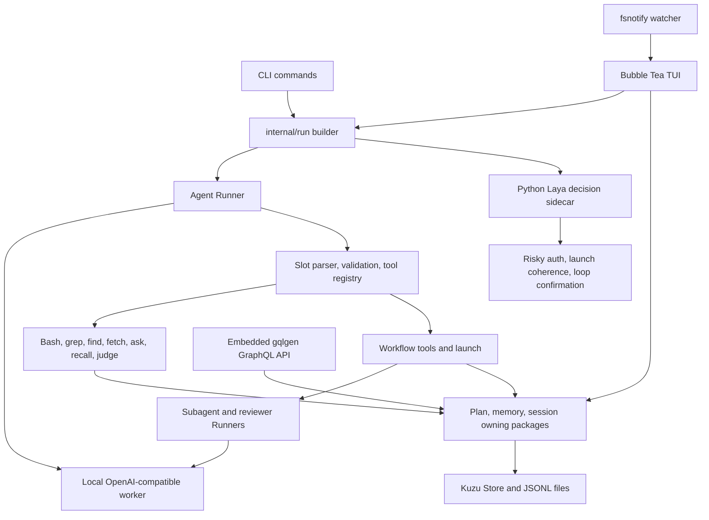

# Specific Harness — codebase review

Review date: 2026-10-09. Scope: the active implementation against Concept.md and the completion claims in ConstructionPlan.md, before advancing to Phase 7 or 8. This is an audit, not an implementation or release qualification.

**Conclusion:** the main components exist and the existing Go suite passes, but the current tree does not satisfy the complete core contract. The highest-priority reproduction is silent record loss when two Store instances open the same Kuzu file. Workflow reporting, cancellation, context integrity, and several TUI controls also have demonstrated gaps. Phase 6 remains open.

ConstructionPlan.md remains the task authority. Its new R01–R30 register contains the proposed repairs, dependencies, acceptance criteria, and verification recipes. Nothing in that register has been implemented or ticked. Historical completion logs are preserved; they are evidence of the earlier checks, not proof that the current tree has no gaps.

## What the product is

The concept is a lightweight local coding harness that makes a small model useful through brief tools, enforced planning, deterministic orchestration, and aggressive context management. The intended user should be able to let the model build and operate a Plan → Approach → Task graph without manually repairing the workflow. Quality gates must distinguish completed work from a stopped run. The TUI is an in-process interface to the same harness, rather than a separate application or HTTP frontend.

The construction sequence has been: foundations and runtime transport → tool loop → persistent state → planning and fan-out → decision model → context management → TUI. Phase 7 is the evolution/error/5k experiment layer; Phase 8 contains expansions such as engine web search. Both still have TBD tasks and gates.

## What the code actually connects

The real reusable seams are sound: CLI and chat share the runner builder; tools share one slot validator; lifecycle logic belongs to the plan package; GraphQL resolvers delegate; session writes belong to the session package; config defaults and the YAML example are drift-pinned. However, state access is partly direct rather than exclusively through GraphQL, and the TUI repeatedly opens independent Kuzu database objects. The writer queue serializes a Store instance, not all access to a database path.

## Review and evidence boundaries

The review covered all active handwritten implementation modules, CLI dispatch, GraphQL schema and resolver bindings, templates, YAML defaults/example, Python sidecar, and the test contracts associated with the plan. The file manifest records 139 files, including 59 handwritten production Go files and 58 Go test files with 510 named test functions. Generated GraphQL wiring was checked against the schema and resolver interfaces; this is not a line-by-line audit of generated boilerplate or third-party dependencies. Parked NPU implementation is outside the active tree.

Evidence is under `verification/2026-10-09-codebase-audit/`: source hashes, a test contract index, original plan-contract extraction, probe sources, raw observations, and binary linkage. Existing build/test logs are under `verification/2026-10-09-t6.10/`.

- Build, vet, and `gofmt -l internal/ cmd/` passed.
- The original full suite produced 23 passing packages and one failing package: `TestServeProbeEntry` depended on installed live Ollama models. With the user's approval, that test alone was changed to the existing fake-transport seam. The uncached full suite then passed: **24 ok / 0 fail**, plus four packages with no tests.
- The requested Settings/parameter/strict-key focused checks passed in all three packages.
- Python sidecar routing/validation tests passed: **8 tests**. These do not execute a decision checkpoint.
- `MUTANT` search in active Go sources is empty. All six production `llm.New` sites chain `WithParams`. Settings has no unfinished suffix scaffolding.
- Audit reproductions used real Kuzu files, real filesystem events, local controlled HTTP servers, scripted model responses, and pure TUI update calls. They are not V-LIVE against an executor or decision model. Overlay probe tests log defects; their PASS means the probe ran, not that the product behavior is correct.
- The attempted initial live Settings session reached startup only. No Settings acceptance check completed. Its artifacts were preserved, its own helper sidecar was stopped, and existing Ollama was left running. No V-LIVE pass is claimed.
- Full-suite hermeticity remains unaudited beyond the approved probe-entry fix. An additional test-isolation candidate is recorded in R29; no other inherited test was changed.
- The tree is untracked, so historical claims such as “run.go changed only by gofmt” cannot be independently established without an earlier copy. Current source was reviewed; no commit, authorship configuration, or unrelated parent-repository change was made.

## Completion claims versus current implementation

| Plan area | Implemented and covered | Current gap or qualification limit |
|---|---|---|
| T0.1–T0.2 scaffold/config | Binary builds; defaults, overlays, strict keys, save validation | Non-finite floats escape validation (R09); several tunables remain hardcoded (R28) |
| T0.3 Kuzu | Real embedded engine; queue and reopen/migration tests | Two handles can lose successful writes (R01); single-binary packaging explicitly deferred (R30) |
| T0.4 client | Plain/SSE transport, usage, params, connection errors | Incomplete/error SSE streams can return success (R07); historical MLX live only, vLLM live never claimed |
| T0.5 hardware | RAM/CPU/platform profile; context and subagent limits | Derived MLX concurrency flags are printed but not included in launch recipes (R28) |
| T1.1–T1.3 registry/bash/search | Schema-on-demand, targeted repairs, bounded returned text, subprocess tests | Cancellation does not reach tools (R04); grep limit and file/glob errors (R19); capture occurs before truncation (R28) |
| T1.4 fetch | HTML/code/link extraction, text handling, caps | Body read errors become empty successful results (R07) |
| T1.5–T1.6 loop/auth/ask | Runner, streams, auth modes, dialogs, explicit failed/blocked tool results | Managed stops can become completed tasks (R03); default free-tool names mismatch registry (R20) |
| T2.1 GraphQL | In-process generated API, thin resolvers, round-trips | Concept's exclusive state boundary and some state fields are absent (R27) |
| T2.2 store | Same-instance concurrent mixed load passes | Per-database ownership and atomic transitions are unproven/insufficient (R01/R05) |
| T2.3 memory | Valid kinds, queries, filters, deterministic recall | Unicode truncation crash (R08); response-addressability contract needs reconciliation (R27) |
| T2.4–T2.5 sessions | JSONL events, GraphQL indexing, CLI read/list/sweep | Last-use retention is last-write mtime; TUI does not sweep (R25) |
| T3.1–T3.3 PAT/templates | Migration, parent existence checks, transition tables, six-field mechanical gate | Closed-parent mutation/reopen holes (R05); article/rule schema and semantic granularity gates absent (R27) |
| T3.4–T3.6 launch/workflows/retire | Sequential/concurrent fan-out, cap, retries, result storage, retire visibility | Model cannot ready/activate/complete its own chain (R06); false done feed (R02), stop handling (R03), child behavior missing (R26) |
| T4.1–T4.3 decision runtime | Strict Go response validation, Python request checks, CPU/GPU routing | Health accepts arbitrary HTTP 200 (R17); NPU retirement is intentional |
| T4.4 AMD NPU | Explicitly deferred | Hardware-gated; not a failed completed task |
| T4.5 mandatory gates | Risky auth, launch goal coherence, loop confirmation | Ready hook remains no-op; block well-formedness, compaction triage, and workflow semantic gates not implemented (R27) |
| T4.6–T4.7 loops/judgments | Repeat/stall tracking, confirmation, judgment log and feed | Stop-as-done is a documented choice needing reconciliation (R03); failed launch results can count as productive (R02) |
| T5.1 usage | Server usage parsing and cumulative run ledger | Footer uses the cumulative ledger as context occupancy (R14); adjusted pruning basis is an estimate (R10) |
| T5.2 compaction | Chained worker summary, budget growth, guards, loud stops | TUI throws away the returned compacted transcript; next turn revives old history (R12); manual compaction is unguarded (R11) |
| T5.3 pruning | Deterministic stubs and preserved session events | Latest-three schemas can be removed; the original prompt can be pruned when behavior is injected (R10) |
| T5.4–T5.5 behavior/recall | Parent behavior injection, automatic and tool recall | Behavior is absent in subagents/reviewers (R26); Unicode recall crash (R08) |
| T6.1/T6.1b shell/chrome | Tabs, router, picker, styling, footer, geometry tests | `/models` remains a placeholder (R18); footer state drifts (R13/R14); async tab ownership (R11) |
| T6.2 and T6.2b–e chat/input | Streams, ask chains, approvals, drafts, history, keymaps, feedback | Cancellation and history issues (R04/R12); shift-history and later input follow-ups still have pending live evidence |
| T6.3 diff | Watcher, ring, attribution, event viewer/comment | First edit lacks baseline; dropped/skipped counts are not shown (R21); live acceptance pending |
| T6.4 plan tree | Store tree, detail, collapse, refs, comments | Short refs renumber after filtering retired nodes (R24); live acceptance pending |
| T6.4b btw | Per-run queue, next-step injection, unheard carry | Heard notes disappear from next-turn history (R12); live injection/carry still pending |
| T6.5 status | Endpoint/model rows, recipes, persist/use, device/model changes | Wrong MLX/OpenAI probe path (R15); Enter discards pull command (R16); model-row CLI actions target default Ollama rather than row URL (R16); health/model skew (R17) |
| T6.6 sessions/titles/tabs | Browser, baseline turns, terminal-tab resume, per-tab chat | Async result ownership (R11); resume fidelity/retention (R12/R25); live terminal resume and retitles pending |
| T6.7 decisions | Current-chat IDs, verdict rows/counts/buckets | Live risky feed pending; counts are capped and do not fully disclose omissions (R28) |
| T6.8 workflows | Monitor, launch/pause/resume, attempts, reviewer pass | Review FAIL reports done; broken reviewer completes work (R02); readiness tool absent (R06); live two-task cycle pending |
| T6.9 files/viewers | Explorer, read-only viewer, quotes, line specs | Viewer content does not refresh (R22); wrapped `/goto` targets wrong display row (R23); live acceptance pending |
| T6.10 Settings | 15-field editor, copy-before-Validate, arm/edit/cancel, params wire | NaN/Inf accepted (R09), footer stale (R13), decision-model changes do not restart the sidecar (R17); all live a–d pending |
| Phase 7 | Behavior-file injection exists from Phase 5 | Evolution mutations, user file, error wiki, and 5k experiment are future work; tasks/gate TBD |
| Phase 8 | Fetch-only direct URLs exist | Engine web search remains explicitly deferred; tasks/gate TBD |

## Reproduced failures

Raw observations below are in `probes-final.log`; async/viewer observations are in `tui-probes.log`. Proposed implementation details live only in the plan register.

| Repair | Observation | Why it matters |
|---|---|---|
| R01 | Two handles each returned a successful memory write; each saw one record; reopen retained one instead of two | The instance-local writer queue does not provide database-wide ownership. The TUI uses this access pattern |
| R02 | Reviewer returned `FAIL no evidence`; task state was failed, but launch said `1/1 tasks done` and `Failed=false` | Model-facing progress contradicts stored truth |
| R02 | Reviewer raised an error; task stayed done and approach became complete | Verification enabled does not imply verification passed; this behavior is explicitly described in T6.8's LOG |
| R03 | A one-step unknown-tool run stopped without a final answer, yet task and approach became done/complete | Run termination is conflated with task success; loop-stop semantics were deliberately pinned earlier |
| R04 | Context was canceled at the model/tool boundary; bash still ran and created an isolated marker | `/stop` cannot guarantee that work has stopped |
| R05 | A new task and edited block were accepted under a complete approach; reopening a task left its parent complete | Completion invariants can be invalidated after their checks |
| R07 | Empty SSE, EOF after partial text, and an SSE error envelope returned nil error | Incomplete output can be promoted to a final answer |
| R07 | HTTP body ended before Content-Length; fetch returned empty text and nil error | Read failure is represented as successful empty content |
| R08 | Recall of `refund ` + 40 `é` characters with maxChars=80 panicked at rune slice [:80], capacity 48 | Mixed byte/rune sizing can crash normal Unicode input |
| R09 | Settings accepted NaN; Validate and Save accepted NaN/+Inf; the next client request could not encode NaN | Copy-before-Validate is correct, but Validate is incomplete |
| R10 | Default keep=3, cap=5% retained one of three schemas | Percentage pruning defeats the protected recent-schema invariant |
| R10 | With a behavior message, a user prompt beginning `tool result:` became a pruned-output stub | Position/prefix classification mistakes user input for an observation |
| R11 | A late title for the source tab renamed the destination tab; late compaction overwrote destination history | Background messages lack stable ownership/version information |
| R13 | Settings switched auth to yolo while footer still read ALL; thinking switched off while footer stayed on | The visible operating mode is stale |
| R15 | A healthy `/v1/models` fixture was probed at `/v1/v1/models` and shown down | The configured OpenAI base is incorrectly joined |
| R16 | Enter on an available model set Loading but returned no command | The promised pull never executes and the UI remains busy |
| R17 | `/health` answered unrelated text with HTTP 200 and was marked up | Health establishes neither service shape nor checkpoint identity |
| R18 | `/models` returned `/models lands in T6.5` | A finished-phase command is still scaffolding |
| R19 | grep limit=1 returned three file matches without truncation; a single matching file plus `*.txt` returned no matches | Limits and filtering differ from their advertised contracts |
| R20 | Default free list contains `search`; actual `grep` invoked the judge | “Free search” is not implemented by those defaults |
| R21 | A preexisting file changed before→after; first event had Added=after and no Removed=before | First edits are additions, not accurate before/after diffs. This is knowingly pinned by an existing test |
| R22 | After disk changed to after and a file-list refresh completed, the open viewer still showed before | Polling refreshes names, not open contents |
| R23 | `/goto 2` after a wrapped first logical line showed its continuation row | Logical lines are used directly as display offsets |

Other findings are established from source rather than a fresh runtime reproduction: model-tool lifecycle gaps (R06), persistence of compacted history (R12), cumulative context meter (R14), ref stability (R24), retention behavior (R25), child behavior omission (R26), concept/schema/gate coverage (R27), and remaining tunables/hardware/limit disclosure (R28). Duplicate-launch races and close/write races are plausible consequences of the current non-atomic lifecycle/ownership code; they are investigation cases in R01/R05, not claimed reproduced failures.

## Source anchors

These are entry points for each finding; the repair contracts and dependencies remain in ConstructionPlan.md. Line numbers identify the reviewed tree.

| Repair | Source |
|---|---|
| R01 | [internal/store/store.go:92](</Users/santiagoaraoz/Desktop/Specific Labs/Specific Harness/internal/store/store.go:92>); [internal/tui/chat.go:350](</Users/santiagoaraoz/Desktop/Specific Labs/Specific Harness/internal/tui/chat.go:350>) |
| R02 | [internal/launch/launch.go:280](</Users/santiagoaraoz/Desktop/Specific Labs/Specific Harness/internal/launch/launch.go:280>); [internal/launch/launch.go:412](</Users/santiagoaraoz/Desktop/Specific Labs/Specific Harness/internal/launch/launch.go:412>) |
| R03 | [internal/agent/agent.go:102](</Users/santiagoaraoz/Desktop/Specific Labs/Specific Harness/internal/agent/agent.go:102>); [internal/launch/launch.go:262](</Users/santiagoaraoz/Desktop/Specific Labs/Specific Harness/internal/launch/launch.go:262>) |
| R04 | [internal/tools/bash/bash.go:46](</Users/santiagoaraoz/Desktop/Specific Labs/Specific Harness/internal/tools/bash/bash.go:46>); [internal/run/run.go:63](</Users/santiagoaraoz/Desktop/Specific Labs/Specific Harness/internal/run/run.go:63>) |
| R05 | [internal/plan/plan.go:160](</Users/santiagoaraoz/Desktop/Specific Labs/Specific Harness/internal/plan/plan.go:160>); [internal/plan/plan.go:441](</Users/santiagoaraoz/Desktop/Specific Labs/Specific Harness/internal/plan/plan.go:441>) |
| R06 | [internal/launch/build.go:18](</Users/santiagoaraoz/Desktop/Specific Labs/Specific Harness/internal/launch/build.go:18>) |
| R07 | [internal/llm/client.go:185](</Users/santiagoaraoz/Desktop/Specific Labs/Specific Harness/internal/llm/client.go:185>); [internal/tools/fetch/fetch.go:80](</Users/santiagoaraoz/Desktop/Specific Labs/Specific Harness/internal/tools/fetch/fetch.go:80>) |
| R08 | [internal/memory/recall.go:66](</Users/santiagoaraoz/Desktop/Specific Labs/Specific Harness/internal/memory/recall.go:66>) |
| R09 | [internal/config/config.go:362](</Users/santiagoaraoz/Desktop/Specific Labs/Specific Harness/internal/config/config.go:362>); [internal/tui/settings.go:131](</Users/santiagoaraoz/Desktop/Specific Labs/Specific Harness/internal/tui/settings.go:131>) |
| R10 | [internal/agent/prune.go:49](</Users/santiagoaraoz/Desktop/Specific Labs/Specific Harness/internal/agent/prune.go:49>) |
| R11 | [internal/tui/chat.go:617](</Users/santiagoaraoz/Desktop/Specific Labs/Specific Harness/internal/tui/chat.go:617>); [internal/tui/chat.go:808](</Users/santiagoaraoz/Desktop/Specific Labs/Specific Harness/internal/tui/chat.go:808>) |
| R12 | [internal/tui/chat.go:419](</Users/santiagoaraoz/Desktop/Specific Labs/Specific Harness/internal/tui/chat.go:419>); [internal/tui/sessions.go:96](</Users/santiagoaraoz/Desktop/Specific Labs/Specific Harness/internal/tui/sessions.go:96>) |
| R13 | [internal/tui/settings.go:198](</Users/santiagoaraoz/Desktop/Specific Labs/Specific Harness/internal/tui/settings.go:198>) |
| R14 | [internal/tui/chat.go:577](</Users/santiagoaraoz/Desktop/Specific Labs/Specific Harness/internal/tui/chat.go:577>) |
| R15 | [internal/serve/serve.go:197](</Users/santiagoaraoz/Desktop/Specific Labs/Specific Harness/internal/serve/serve.go:197>) |
| R16 | [internal/tui/serve.go:571](</Users/santiagoaraoz/Desktop/Specific Labs/Specific Harness/internal/tui/serve.go:571>); [internal/tui/unload.go:62](</Users/santiagoaraoz/Desktop/Specific Labs/Specific Harness/internal/tui/unload.go:62>) |
| R17 | [internal/serve/serve.go:119](</Users/santiagoaraoz/Desktop/Specific Labs/Specific Harness/internal/serve/serve.go:119>); [internal/tui/settings.go:131](</Users/santiagoaraoz/Desktop/Specific Labs/Specific Harness/internal/tui/settings.go:131>) |
| R18 | [internal/tui/app.go:365](</Users/santiagoaraoz/Desktop/Specific Labs/Specific Harness/internal/tui/app.go:365>) |
| R19 | [internal/tools/search/search.go:69](</Users/santiagoaraoz/Desktop/Specific Labs/Specific Harness/internal/tools/search/search.go:69>) |
| R20 | [internal/config/config.go:283](</Users/santiagoaraoz/Desktop/Specific Labs/Specific Harness/internal/config/config.go:283>); [internal/auth/auth.go:46](</Users/santiagoaraoz/Desktop/Specific Labs/Specific Harness/internal/auth/auth.go:46>) |
| R21 | [internal/watch/watch.go:90](</Users/santiagoaraoz/Desktop/Specific Labs/Specific Harness/internal/watch/watch.go:90>); [internal/tui/diff.go:97](</Users/santiagoaraoz/Desktop/Specific Labs/Specific Harness/internal/tui/diff.go:97>) |
| R22 | [internal/tui/files.go:112](</Users/santiagoaraoz/Desktop/Specific Labs/Specific Harness/internal/tui/files.go:112>) |
| R23 | [internal/tui/fileview.go:58](</Users/santiagoaraoz/Desktop/Specific Labs/Specific Harness/internal/tui/fileview.go:58>); [internal/tui/chat.go:963](</Users/santiagoaraoz/Desktop/Specific Labs/Specific Harness/internal/tui/chat.go:963>) |
| R24 | [internal/tui/plans.go:84](</Users/santiagoaraoz/Desktop/Specific Labs/Specific Harness/internal/tui/plans.go:84>); [internal/tui/plans.go:135](</Users/santiagoaraoz/Desktop/Specific Labs/Specific Harness/internal/tui/plans.go:135>) |
| R25 | [internal/session/session.go:111](</Users/santiagoaraoz/Desktop/Specific Labs/Specific Harness/internal/session/session.go:111>); [cmd/specific-harness/main.go:177](</Users/santiagoaraoz/Desktop/Specific Labs/Specific Harness/cmd/specific-harness/main.go:177>) |
| R26 | [internal/run/run.go:108](</Users/santiagoaraoz/Desktop/Specific Labs/Specific Harness/internal/run/run.go:108>); [internal/launch/launch.go:262](</Users/santiagoaraoz/Desktop/Specific Labs/Specific Harness/internal/launch/launch.go:262>) |
| R27 | [Concept.md:28](</Users/santiagoaraoz/Desktop/Specific Labs/Specific Harness/Concept.md:28>); [internal/plan/plan.go:83](</Users/santiagoaraoz/Desktop/Specific Labs/Specific Harness/internal/plan/plan.go:83>); [schema/v1.graphqls:1](</Users/santiagoaraoz/Desktop/Specific Labs/Specific Harness/schema/v1.graphqls:1>) |
| R28 | [internal/tools/bash/bash.go:46](</Users/santiagoaraoz/Desktop/Specific Labs/Specific Harness/internal/tools/bash/bash.go:46>); [internal/tui/files.go:149](</Users/santiagoaraoz/Desktop/Specific Labs/Specific Harness/internal/tui/files.go:149>); [internal/serve/serve.go:274](</Users/santiagoaraoz/Desktop/Specific Labs/Specific Harness/internal/serve/serve.go:274>) |
| R29 | [specific-harness-inventory.md:29](</Users/santiagoaraoz/Desktop/Specific Labs/Specific Harness/specific-harness-inventory.md:29>); [internal/tui/decisions_test.go:123](</Users/santiagoaraoz/Desktop/Specific Labs/Specific Harness/internal/tui/decisions_test.go:123>) |
| R30 | [verification/2026-10-09-codebase-audit/binary-linkage.log:1](</Users/santiagoaraoz/Desktop/Specific Labs/Specific Harness/verification/2026-10-09-codebase-audit/binary-linkage.log:1>) |

## Why existing green checks did not catch these

Several tests cover an internal helper without the public path or interaction that changes its meaning. Store contention tests share one Store. OpenAI probe tests use a bare base URL, unlike shipped `/v1` defaults. `TestServeModelEnter` checks the available-model branch by directly calling `serveLoad`, rather than asserting the Enter command. Latest-schema tests disable the percentage cap, while percentage tests permit removing recent schemas. Recall truncation tests use ASCII. Title/compact tests deliver results to the same active chat. Workflow verification tests inspect node state but not the parent feed. The workflow build-chain test manually readies/runs the approach through package APIs, filling a transition the model cannot perform with its tools.

These tests establish useful mechanisms. They do not establish the full user/model workflow. Repair verification must exercise the interaction that reproduced the gap, prove the new assertion red on the pre-fix tree, and then retain the broader suite.

## Accepted choices and real deferrals

Preserve these unless the owner explicitly changes them:

- Strict KnownFields YAML decoding is intentional typo protection. Unknown keys must continue to refuse; do not implement silent round-tripping.
- Kuzu is the settled storage choice. R01 is an ownership repair, not permission to substitute SQLite.
- NPU serving was retired to `future/`; GPU/CPU decision serving is active. AMD work waits for hardware.
- Live vLLM qualification requires the appropriate host and was never claimed by the historical MLX gate.
- Child session files are explicitly deferred. Missing child behavior injection is a separate issue; adding child logs is not needed to fix it.
- Minimal queue/retries, direct subagent execution after launch approval, current-chat-only decisions, terminal-tab resume, parent-only recall/judge tools, and total-RAM concurrency heuristics are recorded design choices. Do not silently expand them while repairing defects.
- Managed loop stops returning a done event/exit 0 and broken reviewers not rejecting work are documented behaviors. The audit proves their consequences for completion truth. R03/R02 call for explicit outcome handling and an owner decision where policy changes, not an unannounced reversal.
- Native dylib/assets packaging is a pre-distribution deferral. Current linkage proves the development binary is not a self-contained distribution (R30).

## Repair sequence and admission to the next phases

First repair database ownership (R01), truthful outcomes/reporting (R02/R03/R07), cancellation (R04), and graph/model workflow integrity (R05/R06). Resolve the core concept contract in R27 before freezing the interfaces that Phase 7's automatic mutations will use. Then repair context/history/behavior (R08–R12/R14/R26), followed by the TUI/runtime/search/retention contracts (R13/R15–R25). R28 reconciles limits and configuration. R29 closes proof/documentation gaps. R30 stays at the acknowledged distribution boundary.

Phase 6 exit requires current build/test evidence, the accepted repair disposition, and completed real-model TUI checks. The pending live checklist includes Settings a–d; input/shift-history and ask follow-ups; first file edit/comment; live plan navigation; mid-run btw and carry; runtime use/start/load/unload/device/model/restart/quit; terminal-tab resume/titles and independent chats; risky decision feed; launch→pause→resume with review truth; MEMORY; file/goto/comment and diff line quoting. Preserve failures as evidence and update the relevant existing LOG entries with dated corrections. Do not reuse controlled audit probes as V-LIVE receipts.

Only after that review/repair gate should Phase 7's tasks and acceptance experiment be drafted, followed by scheduled Phase 8 expansions. No README/guide, Phase 7, or Phase 8 implementation was started in this audit.

## Current evaluation reconciliation — 2026-10-09

The sections above preserve the initial source audit and its pending live checklist. The subsequent Mac-local evaluation is recorded in verification/2026-10-09-product-eval/EVALUATION_REPORT.md and the 55-row contracts/FINAL_COVERAGE_DRAFT.md. ConstructionPlan now has R01–R39, all proposed/open, grouped into seven packages A–G. This supersedes the initial R01–R30 and live-pending scope statements without changing historical ticks or LOGs.

Actual Settings a–d worked with finite values. Later real controls expose non-finite settings, false completion despite actual failed checks, cancellation leaving owned commands running, lost summaries/heard notes/tool evidence, unread-output pruning, ineffective thinking settings, missing child behavior, model Enter/refresh defects, stale plan-detail routes/ambiguous refs, and source-view/search fidelity. The matched coding pilot is 0/4 Harness versus 0/4 native baseline; it establishes no uplift. Fixed system plus all tool schemas is about1.6–1.7k tokens in measured tokenizers. Clean-host installation, independent novice learning and several explicitly attempted live mechanisms remain unqualified. See the report for proof levels and limits.

R30 remains historically deferred, but the requested install-and-run product claim now makes native layout/assets qualification necessary before readiness. The seven-package plan takes this up explicitly. No repair, README/guide, Phase6 exit, Phase7/8 implementation or commit is authorized by the evaluation.
